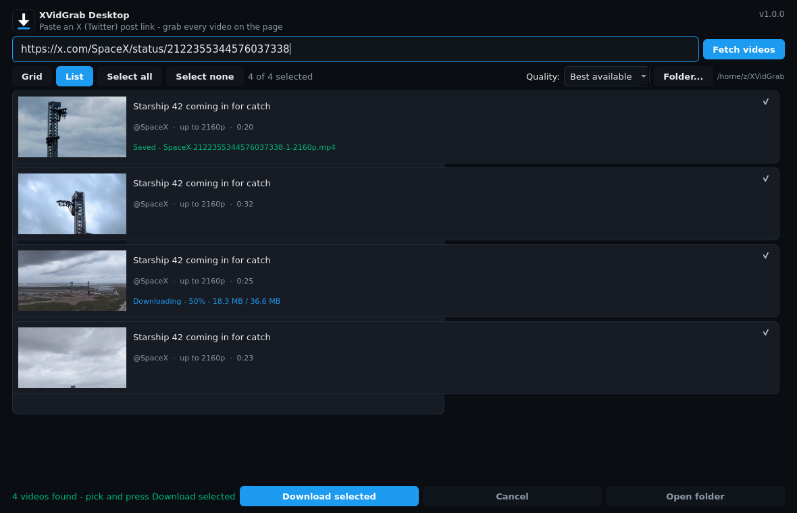

# XVidGrab Desktop

---

**XVidGrab Desktop** is part of the [3SVerse](https://3sverse.com) suite — software, systems & operations. More free tools at [3sverse.com](https://3sverse.com). The [browser extension](extension/) lives in this same repo now, under `extension/` — both the desktop app and the extension ship together from every [Release](../../releases/latest).

**XVidGrab Desktop** is a free, open-source **GUI video downloader for X
(formerly Twitter)**. Paste a post link and it shows **every video on that
page** with live thumbnails and the best quality available (480p, 720p, 1080p,
4K — whatever the post has). Tick the ones you want — or hit **Select all** —
and download them in one go.

Paste **any x.com link** instead — a profile (`x.com/Kazimirol2`), a
`/media` tab, a **search link** (`x.com/search?q=...`) or even a DM **chat
link** (`x.com/i/chat/...`) — and the app opens it **in a window inside the
app itself**, **auto-scrolls the page to the very end** and puts **every
video on the page** into the download list — thumbnails, qualities, all of
it. No external browser, no browser windows — when X asks for a login you
log in right inside the XVidGrab window (once; the app remembers you). The
**Multiple pages** window adds several links at once, joining the
already-running fetch.

Two polished interfaces are included, both with **list view and grid view**:

| Build | GUI toolkit | File |
|---|---|---|
| `XVidGrab-Desktop-Qt.exe` | PySide6 / Qt (recommended) | `xvidgrab_desktop_qt.py` |
| `XVidGrab-Desktop.exe` | Tkinter (lightweight alternative) | `xvidgrab_desktop.py` |

No accounts, no API keys, no cookies, no telemetry. Video discovery uses the
same public embed data source X serves to every website on the internet.

## Screenshots

**Grid view** — thumbnail cards with checkboxes, quality badges and durations
(Tkinter build, live SpaceX post with four videos):

**List view** — compact rows with per-video download status (Qt build):

## Features

- **Any x.com link works (v1.3.0)** — paste a single post, a whole
  **profile** (`x.com/Kazimirol2`), a `/media` tab, `/with_replies`, a
  **search page**, a hashtag/explore page — even a **DM chat link**
  (`x.com/i/chat/...`) — and the app fetches **every video on that page**.
  No more "post link or search link only" error: every X link is fetchable.
- **Multiple pages (v1.3.0)** — a dedicated paste window (one link per
  line). Press **Add to fetch list** and the links **join the
  already-running fetch** — page links queue up behind the one currently
  being collected, post links resolve alongside it. Detection shows how
  many links were recognised before you submit.
- **Search-page fetching, fully in-app** — paste a search link like
  `https://x.com/search?q=backshots&src=recent_search_click` and the page
  opens **inside the app** (embedded Chromium). The app scrolls to the very
  end of the feed and lists **every video on the page** for download (press
  **Stop** any time to use what has been collected so far). **The X login
  happens inside the app window too** — one time only, then remembered.
- **Profile timelines scroll too** — profile, `/media` and `/with_replies`
  pages use the same in-app collector: open, (log in if asked), scroll to
  the end, every video post resolved and listed.
- **DM chat videos** — paste `x.com/i/chat/...`, log in once inside the app,
  and the collector walks the conversation history (nudging every video so
  its real stream is captured) and lists the chat's videos.
- **Paste a link, get everything** — every video of the post appears with its
  thumbnail, duration and available qualities (multi-video posts show all of
  them)
- **Thumbnails everywhere (hardened)** — live preview for each video; when
  the direct image request is blocked (VPNs, proxies, ISP-level image-CDN
  blocks), thumbnails are retried with browser-style headers and finally
  through the embedded browser session itself, so they show up even where
  plain requests cannot reach `pbs.twimg.com`
- **List view / grid view** — switch layouts any time; your choice is
  remembered
- **Selection your way** — tick videos one by one, or Select all / Select none
- **Max resolution by default** — downloads pick the highest quality stream
  the post offers; optionally cap it (e.g. 720p) from the Quality dropdown
- **Multiple links in one paste** — paste a whole list of links; every X
  link in it is fetched (`t.co` short links are resolved too, and a lone
  `@username` or bare tweet id works as well)
- **Parallel downloads with live progress** — per-video percentage, overall
  progress bar, cancel any time
- **Sensible file names** — `@user-<post id>-<quality>.mp4`, saved to
  `Downloads\XVidGrab` by default (configurable)
- **Two GUIs, one engine** — a light Tkinter build and a Qt (PySide6) build,
  sharing the same `xgrab_core.py` engine

## How page fetching works

X has no public timeline API and timelines/search results need a
logged-in session, so the Qt build loads any page link in an **embedded
Chromium browser window inside the app** (PySide6 QtWebEngine — the same
engine Edge uses):

1. The page opens in the XVidGrab window itself (profile, search, /media,
   chat — whatever you pasted). If X asks for a login, an amber banner
   appears — **log in right there** (one time only). The session lives in
   the app's own persistent profile (`XVidGrab-WebViewProfile` in your home
   folder), so every later run — and every later app start — is already
   logged in. No browser windows, nothing opens outside the app.
2. It auto-scrolls the feed to the very end — the same proven collector the
   XVidGrab extension's *Fetch All* uses (feed end = page height and collected
   count stable, 12-minute safety cap). DM chats are walked history-up
   instead, capturing each video's real stream from the page's own network
   traffic.
3. Every video card it passes is harvested — including tiles that only expose
   a `/status/<id>/video/1` link (unplayed videos do not autoplay, so this is
   the only reliable shape on unplayed cards).
4. Each collected post is resolved through the public embed data source, so
   every video lands in the normal list with thumbnail, duration and quality
   options — ready to download.
5. More links can be added **while this is running** — open **Multiple
   pages**, paste one per line, press **Add to fetch list**, and they join
   the running fetch automatically.

The lightweight Tkinter build keeps the legacy route (selenium + a real Edge
window with its own `XVidGrab-EdgeProfile`); it needs Microsoft Edge
installed. The Qt build needs nothing beyond the app itself.

## Requirements

- Windows 10/11 for the ready-made EXEs (download from [Releases](../../releases))
- Or Python 3.9+ on any desktop platform (Windows / macOS / Linux)

## Setup (from source)

    python -m pip install -r requirements.txt

## Usage

1. Run the app:

       python xvidgrab_desktop_qt.py     (Qt build, recommended)
       python xvidgrab_desktop.py        (Tkinter build)

2. Copy **any x.com link** — for example
   `https://x.com/SpaceX/status/2122355344576037338`, a profile like
   `https://x.com/Kazimirol2`, `/media`, a search link like
   `https://x.com/search?q=cats&f=live`, or a DM chat link — and paste it
   into the top bar (several links in one paste are fine).
3. Press **Fetch videos**. Every video on the page shows up as a thumbnail
   card. For profile/search/chat links, the page opens in a window **inside
   the app** and the app scrolls it to the end first — if X asks you to log
   in, do it right there in that window (once). Press **Stop** any time to
   use what has been collected so far.
3b. Or press **Multiple pages** to paste several links at once and add
   them to the already-running fetch.
4. Switch between **Grid** and **List** views any time.
5. Tick the videos you want — or press **Select all**.
6. Pick a quality (default: **Best available**) and a folder if you like.
7. Press **Download selected**. Watch the live progress, then open the folder
   straight from the app.

## Notes & limits

- Works with **public** content. Deleted or private posts can't be fetched
  (you'll get a clear error message instead); age-gated/sensitive posts are
  recovered through the in-app logged-in session when possible.
- Timelines, search and DM chats need an X login (X requires it); in the Qt
  build you log in once **inside the app window** and the app remembers you
  (the Tkinter build asks inside its Edge window instead, and its DM-chat
  support needs the Qt build's embedded browser).
- Animated GIFs are downloaded as looping MP4 videos (that is how X serves
  them).
- If X changes its public embed data, the engine may need an update — pull
  requests welcome.

## Bundled browser extension

This repository also carries the **XVidGrab browser extension** (the
one-click X video downloader for Chromium & Firefox) under
[`extension/`](extension/) — including the v1.2.0 search-page fix and the
Fetch All scroll-to-end collector. See
[extension/README.md](extension/README.md) for its documentation, or install
it from the [xvidgrab releases](https://github.com/abaduchanna/xvidgrab/releases).

## Building the EXE (optional)

Both EXEs build automatically on every push via GitHub Actions
(`.github/workflows/build.yml`). To build locally on Windows:

    python -m pip install -r requirements.txt pyinstaller
    python -m PyInstaller xvidgrab_desktop.spec --noconfirm --clean
    python -m PyInstaller xvidgrab_desktop_qt.spec --noconfirm --clean

The EXEs appear in `dist\XVidGrab-Desktop.exe` and `dist\XVidGrab-Desktop-Qt.exe`.

## Legal

Download only content you have the right to save. Respect copyright, the
rights of the original posters and X's Terms of Service. This project is not
affiliated with, endorsed by, or sponsored by X Corp.

## License

MIT — see [LICENSE](LICENSE).

---

Developed by **www.3SVerse.com** — software, systems & operations.
