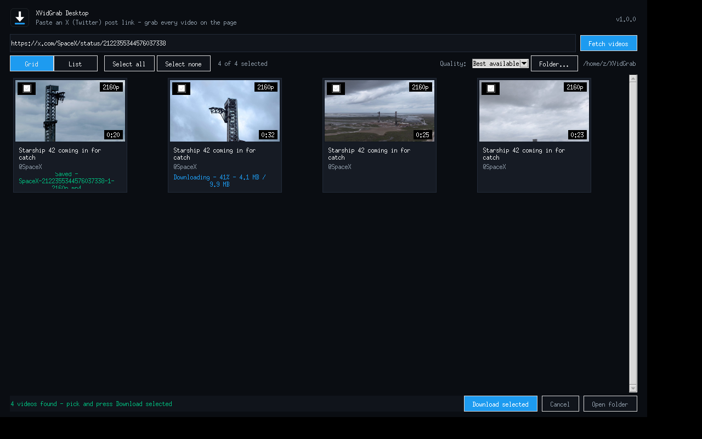

# XVidGrab Desktop

---

**XVidGrab Desktop** is part of the [3SVerse](https://3sverse.com) suite — software, systems & operations. More free tools at [3sverse.com](https://3sverse.com). It is the desktop companion of the [XVidGrab browser extension](https://github.com/abaduchanna/xvidgrab).

**XVidGrab Desktop** is a free, open-source **GUI video downloader for X
(formerly Twitter)**. Paste a post link and it shows **every video on that
page** with live thumbnails and the best quality available (480p, 720p, 1080p,
4K — whatever the post has). Tick the ones you want — or hit **Select all** —
and download them in one go.

Two polished interfaces are included, both with **list view and grid view**:

| Build | GUI toolkit | File |
|---|---|---|
| `XVidGrab-Desktop-Qt.exe` | PySide6 / Qt (recommended) | `xvidgrab_desktop_qt.py` |
| `XVidGrab-Desktop.exe` | Tkinter (lightweight alternative) | `xvidgrab_desktop.py` |

No accounts, no API keys, no cookies, no telemetry. Video discovery uses the
same public embed data source X serves to every website on the internet.

## Screenshots

**Grid view** — thumbnail cards with checkboxes, quality badges and durations
(Tkinter build, live SpaceX post with four videos):

**List view** — compact rows with per-video download status (Qt build):

## Features

- **Paste a link, get everything** — every video of the post appears with its
  thumbnail, duration and available qualities (multi-video posts show all of
  them)
- **Thumbnails everywhere** — a live preview image for each video, in list
  style and grid style
- **List view / grid view** — switch layouts any time; your choice is
  remembered
- **Selection your way** — tick videos one by one, or Select all / Select none
- **Max resolution by default** — downloads pick the highest quality stream
  the post offers; optionally cap it (e.g. 720p) from the Quality dropdown
- **Multiple links in one paste** — paste a whole chat transcript; every X
  post link in it is fetched (`t.co` short links are resolved too)
- **Parallel downloads with live progress** — per-video percentage, overall
  progress bar, cancel any time
- **Sensible file names** — `@user-<post id>-<quality>.mp4`, saved to
  `Downloads\XVidGrab` by default (configurable)
- **Two GUIs, one engine** — a light Tkinter build and a Qt (PySide6) build,
  sharing the same `xgrab_core.py` engine

## Requirements

- Windows 10/11 for the ready-made EXEs (download from [Releases](../../releases))
- Or Python 3.9+ on any desktop platform (Windows / macOS / Linux)

## Setup (from source)

    python -m pip install -r requirements.txt

## Usage

1. Run the app:

       python xvidgrab_desktop_qt.py     (Qt build, recommended)
       python xvidgrab_desktop.py        (Tkinter build)

2. Copy an X post link — for example
   `https://x.com/SpaceX/status/2122355344576037338` — and paste it into the
   top bar (several links in one paste are fine).
3. Press **Fetch videos**. Every video on the page shows up as a thumbnail
   card.
4. Switch between **Grid** and **List** views any time.
5. Tick the videos you want — or press **Select all**.
6. Pick a quality (default: **Best available**) and a folder if you like.
7. Press **Download selected**. Watch the live progress, then open the folder
   straight from the app.

## Notes & limits

- Works with **public** posts. Deleted, private or age-gated posts can't be
  fetched (you'll get a clear error message instead).
- Profile/timeline pages are not supported — paste the individual post links.
- Animated GIFs are downloaded as looping MP4 videos (that is how X serves
  them).
- If X changes its public embed data, the engine may need an update — pull
  requests welcome.

## Building the EXE (optional)

Both EXEs build automatically on every push via GitHub Actions
(`.github/workflows/build.yml`). To build locally on Windows:

    python -m pip install -r requirements.txt pyinstaller
    python -m PyInstaller xvidgrab_desktop.spec --noconfirm --clean
    python -m PyInstaller xvidgrab_desktop_qt.spec --noconfirm --clean

The EXEs appear in `dist\XVidGrab-Desktop.exe` and `dist\XVidGrab-Desktop-Qt.exe`.

## Legal

Download only content you have the right to save. Respect copyright, the
rights of the original posters and X's Terms of Service. This project is not
affiliated with, endorsed by, or sponsored by X Corp.

## License

MIT — see [LICENSE](LICENSE).

---

Developed by **www.3SVerse.com** — software, systems & operations.
